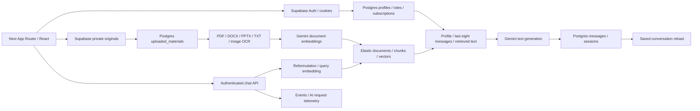

# Lerna AI repository and local runtime audit

**Date:** 12 October 2026, Africa/Lagos. **Branch:** main. **Commit:** 9b37a7e8de96b09340ef4ecb5d0ded52840f5476 (2026-10-01).

**Root for every source reference:** `C:/Users/USER/Desktop/CODE PROJECTS/SMART TUTOR AI/`. References identify the exact file and one-based line at the audited commit. Origin: https://github.com/raymondstudio/Lerna. Deployed commit and production configuration were not inspected.

## Conclusion and evidence limits

This is a substantial existing Next 16/React 19 application with SQL-backed conversations, extraction/Elastic retrieval, role-specific onboarding, study mode, quizzes, support and admin tooling. It is not a minimal prototype. This checkout cannot currently render the root UI or complete its build with installed dependencies. Its production-capable simulation, telemetry, authorization and reporting paths also contain concrete defects. A feature stage would build on unreliable learning and operational evidence.

No complete authenticated learner journey was verified. Verified local behavior consists of selected anonymous API guards, a protected-page redirect, basic document parsers and isolated helper/failure behavior. Credentials existed locally but were not exercised; production was not contacted, no paid model calls were made, and no backend records were created. Remote schema, RLS, storage policies, model availability and Elastic subscription state remain unknown. Severity describes consequence if this code/schema is used, not a claim that deployment exhibits every finding. No P0 is assigned: immediate production exposure/outage was not established. Review guidance used: Supabase, Supabase Postgres Best Practices (privileges/pagination/RLS) and Web Interface Guidelines; browser automation was attempted through the available CUA browser API.

## Scope and preservation

Read the supplied prompt and direct request, with the direct request as authority. Inspected ancestor/application instruction locations, README, previous audits, scripts/lockfile, lint/compiler/Next configuration, migrations by focused search, and critical auth/onboarding/chat/material/session/admin/support/billing source. No applicable AGENTS.md was found; the video composition's instructions are outside this application audit. Old audits were preserved as historical documents.

Initial Git state: 1,356 tracked deletions under brag-output/tools/py/ with access warnings, no reported application changes. No audit action restored, deleted or moved those files. Later status queries stopped listing these inaccessible generated files; the reported missing-file state was inconsistent, so final status is not proof they were recovered. Only documentation intentionally added. Next generated caches and rewrote next-env.d.ts during checks; tracked content restored afterwards. Git still marks next-env.d.ts touched, but git diff reports no content change (working bytes normalize to the same tracked blob); the index was not rewritten. No packages, fixes, schemas, credentials, deployment or production configuration changed. Migrations, bootstrap-admin and institution seed commands were not run. Whole Git history, production infrastructure and video binaries were outside coverage.

## Architecture and critical journey

- **Auth:** password/Google flows at [src/providers/auth-provider.tsx:174](<C:/Users/USER/Desktop/CODE PROJECTS/SMART TUTOR AI/src/providers/auth-provider.tsx:174>) and `:247`. URL builder prioritizes configured APP_URL over browser origin ([src/lib/supabase/config.ts:15](<C:/Users/USER/Desktop/CODE PROJECTS/SMART TUTOR AI/src/lib/supabase/config.ts:15>)). Callback exchanges PKCE code and writes response cookies ([src/app/auth/callback/route.ts:65](<C:/Users/USER/Desktop/CODE PROJECTS/SMART TUTOR AI/src/app/auth/callback/route.ts:65>)). Browser client singleton; server client uses Next cookies, catches RSC writes. Root validates user before getSession ([src/app/layout.tsx:67](<C:/Users/USER/Desktop/CODE PROJECTS/SMART TUTOR AI/src/app/layout.tsx:67>)). Proxy guards matched learner pages; dashboard layout adds requireUser. Next 16 DOES recognize proxy.ts: observed /chat redirect/log contradict its comments and old audits.
- **Onboarding:** role-specific UI, per-user localStorage draft, profile load and optional details/goals; server Zod then complete_onboarding RPC. September migration uses SECURITY INVOKER, explicit self identity/accepted role checks, transactional profile update and compatibility trigger. School is optional for all roles in current validator/RPC. July required institution for students/teachers; deployed replacement unknown. Chat actually calls profile normalization/role context ([src/lib/chat/service.ts:125](<C:/Users/USER/Desktop/CODE PROJECTS/SMART TUTOR AI/src/lib/chat/service.ts:125>), [src/lib/profile.ts:232](<C:/Users/USER/Desktop/CODE PROJECTS/SMART TUTOR AI/src/lib/profile.ts:232>)); model effect unmeasured.
- **Upload:** chat posts file/session to /api/upload; library uploads to Storage then metadata/process APIs; courses/study directly upload/insert/background process. Separate paths have differing format/error handling. Elastic uses raw server fetch; installed @elastic/elasticsearch and legacy @google/generative-ai have no application imports. Unused ChatContainer remains alongside active StudyWorkspace and study InlineChat.
- **Processing:** entire-file download -> extraction -> per-segment word chunks (~800 estimated tokens, 120 overlap) -> sequential Gemini 768-vector calls -> delete prior index entries -> index document/chunks/vectors -> refresh three indices -> SQL ready. Full text lives in Elastic, SQL has summary (first 900 characters), metadata/status/count and original path. Scanned PDFs have no OCR branch. Image handling transcribes text; chat does not receive original diagrams as multimodal input.
- **Question:** authenticate; owned session lookup/create; explicit course/material ownership check; SQL user message; resolve material IDs; reformulate follow-up; query embedding; user-filtered kNN; profile fetch; concatenate instructions, last eight client-supplied messages, profile and excerpts into one text prompt. Sources identify retrieval, not verified claim-level citations. SQL assistant save -> preview update -> entire nested-message reload -> JSON. No token streaming, provider retry policy, send cancellation or idempotency. Separate load/reference requests have cancellation.
- **Persistence:** Supabase owns conversations, contrary to README's Elastic session memory. Timestamp ordering lacks stable tie-breaker/message pagination. SQL/index writes are separate. Quiz header then questions; notes on both session and notes table. Upload/system/error and optimistic chat bubbles also live temporarily in React state.
- **Admin:** overview, users/details/moderation/roles, learning/AI analytics, reports/exports, institutions, health, billing/coupons, marketing/referrals, announcements, feedback, support, settings/features and agent concepts. Tabs do not establish operational correctness. Most APIs check is_admin plus email/app_metadata fallback; exports use centralized guard. Broadcast GET/replies are exceptions. No active autonomous business agent or email worker found.

See LERNA_PROJECT_CONTEXT.md for versions and canonical integration/data mapping.

## Feature-status matrix

Verified working means only the stated local component/check. Implemented but unverified means a traced path without real service success. Partial means incomplete end-to-end. Broken means reproduced behavior or incompatible contract. Planned/absent does not make historical discussion active.

| Capability | Status | Evidence and limit |
| --- | --- | --- |
| Password signup/login/reset/logout | Implemented but unverified | Supabase methods/forms exist; no account/service flow; email check unthrottled. |
| Google sign-in | Implemented but unverified; defects | PKCE callback exists; unsafe next/logs F04; reported local redirect cause unknown. |
| Anonymous guards / protected chat | Verified working locally | Chat/materials/tickets/exports 401; /chat 307 local login; authenticated isolation not proven. |
| Role onboarding | Implemented but unverified end to end | Five-role schema accepts omitted school and correct student flag in VM; current SQL removes requirement; persistence not run. |
| Personalization | Implemented but unverified | Completed-profile, role/context/preferences path used; model behavior untested. |
| General questions without upload | Implemented but unverified | No document required; unsafe fallbacks/failure-success handling F02/F03. |
| PDF | Basic extraction verified; upload unverified | Three bundled parser fixtures: 14/5/5 nonempty page segments with correct labels. Scanned PDFs/equations/tables untested. Handcrafted fixture failed, excluded as app-defect evidence. |
| PPTX | Basic text extraction verified; upload unverified | Synthetic XML slides 10,2,1 return 1,2,10 and text. Notes/diagrams not tested; chat picker PDF-only. |
| DOCX / TXT | Basic extraction verified; upload unverified | Synthetic text recovered; formatting/tables and real storage untested. |
| Images/vision | Partial | Library accepts PNG/JPEG/WEBP; OCR code exists; only mock behavior tested; diagrams not given to chat. |
| Material questions/follow-ups | Partial | Scoped retrieval present; low relevance/empty-context behavior and hidden source list F07; no real grounding eval. |
| Saved sessions/titles/reopen/delete | Implemented but unverified | SQL APIs/URL reload/sources migration traced; retry/partial-write/pagination F06/F15. |
| Material tagging | Partial | Mention keyboard/ownership path exists; material scope per-request, course scope persists. Historical exact symptom unknown. |
| Library/view/reprocess/delete | Implemented but unverified | Metadata, signed URL, lifecycle paths; orphan/stale-index problems F08/F15. |
| Courses/subject selection | Implemented but unverified | CRUD and study/quiz selection traced; no live persistence. |
| Weekday/time lesson scheduling | Absent | No schedule page/API/weekday flow. Chat plan prose, reminder preferences and broadcast scheduling are different. |
| Model selector | Absent | Hard-coded models; no wired selector/alternatives. |
| Study timer/notes/summaries | Partial | Timer/autosave/summary exists; repeated notes-table upsert F15; no reload check. |
| Quizzes/flashcards/written | Partial | Generate/client grade/save/reopen exists; prompt demands four options for every type, filename fallback/partial save F07/F15. |
| Progress | Partial, beyond historical report | Account aggregates/quiz history/durations exist; no /progress or mastery system; integrity unverified. |
| Voice | Planned; active feature absent | Coming-soon/preference/entitlement only; no audio pipeline; comparison copy marks available. |
| Offline AI | Absent | Simulations are not inference; sw.js unregisters itself; no local model or durable offline store. |
| Paystack/live monetization | Partial foundation; live payments absent | Mock checkout/unconditional success adapters; no real payment routes found; no payment made. |
| Admin management | Implemented but unverified | Broad APIs/RPCs; moderation/access gaps F05/F12. |
| Historical analytics | Broken contract | UI/range/new SQL exists; API mismatched legacy RPC/parameters F10. |
| CSV/JSON exports | Partial | Guarded/range-filtered/paged/escaped; users selects removed plan, paging unstable F10; no real export. |
| Support/staff replies | Partial | Native intake/admin storage UI; joins and learner delivery incomplete F13; Formspree absent. |
| Mobile/desktop/accessibility | Render unverified | Bounded shell/composer/focus work exists; UI 500/browser attach blocks visual test; latest-scroll/labels F14. |

## Prioritized findings

### F01 — P1: local application cannot render; checks unusable

**Impact/evidence:** Root / returns 500. npm ls reports missing React Query/devtools despite locked 5.104.0. [src/components/providers.tsx:6](<C:/Users/USER/Desktop/CODE PROJECTS/SMART TUTOR AI/src/components/providers.tsx:6>) and five hooks require it. Build fails on imports and Google Font fetches ([src/app/layout.tsx:2](<C:/Users/USER/Desktop/CODE PROJECTS/SMART TUTOR AI/src/app/layout.tsx:2>)). Type-check: missing imports, seven implicit-any errors, twelve stale generated route-module references. [package.json:9](<C:/Users/USER/Desktop/CODE PROJECTS/SMART TUTOR AI/package.json:9>) uses removed next lint; direct ESLint lacks flat config ([.eslintrc.json:1](<C:/Users/USER/Desktop/CODE PROJECTS/SMART TUTOR AI/.eslintrc.json:1>); config-next 15 vs Next 16).

**Cause:** incomplete local installation/lint migration; stale cache separate. Font failure is network/environment, not proven bad code. **Fix/dependencies:** restore exact locked install; regenerate artifacts; align lint command/config; evaluate residual types and reproducible fonts. **Verify:** clean install, lint/types/build pass without disabled checks; root/dashboard render. **Confidence:** high locally; deployment unknown. No audit installation performed.

### F02 — P1: simulation persisted/counted as real model success

**Evidence:** [src/lib/gemini/client.ts:233](<C:/Users/USER/Desktop/CODE PROJECTS/SMART TUTOR AI/src/lib/gemini/client.ts:233>), `:294`, `:340`, `:431` return canned tutoring, fake vectors/OCR for missing key or broadly classified auth/invalid-argument errors, without dev-only guard. Completion events use live-model labels and no simulation flag. Production-mode VM reproduced mock text/embedding/OCR and three completion events. [src/lib/materials/ingestion.ts:124](<C:/Users/USER/Desktop/CODE PROJECTS/SMART TUTOR AI/src/lib/materials/ingestion.ts:124>), `:142` can mark these ready.

**Impact:** invented document understanding, incompatible fake/real semantic vectors, distorted founder success/tokens/cost. **Fix:** explicit isolated simulation; fail live dependency errors; version embeddings; record mode/outcome; identify affected records before reprocessing. **Verify:** missing/invalid key never creates ready live material/success telemetry; simulation visibly distinct/excluded. **Confidence:** high reproduced behavior; affected production records unknown.

### F03 — P1: provider outages become ordinary assistant messages and successes

**Evidence:** [src/lib/chat/service.ts:49](<C:/Users/USER/Desktop/CODE PROJECTS/SMART TUTOR AI/src/lib/chat/service.ts:49>) catches generateText error and returns apology/zero usage; [src/app/api/chat/route.ts:333](<C:/Users/USER/Desktop/CODE PROJECTS/SMART TUTOR AI/src/app/api/chat/route.ts:333>) saves it and `:341` logs success. Provider-outage stub reproduced service success return containing error text. Empty response has similar handling.

**Impact:** broken tutoring presented/counted as success; diagnostic text reaches users; recovery obscured. **Fix:** typed failure/exception, meaningful client error; separate attempts/messages/completions. **Verify:** 429/auth/outage/empty result produce recoverable error, one failed attempt, zero completion and no false assistant success. **Confidence:** high static and isolated service test; real route writes untested.

### F04 — P1: OAuth logs credential-bearing URL and trusts external next

**Evidence:** [src/app/auth/callback/route.ts:14](<C:/Users/USER/Desktop/CODE PROJECTS/SMART TUTOR AI/src/app/auth/callback/route.ts:14>) logs fullUrl/allParams including code despite truncated-code comment. `:8`, `:59` trust next. Successful-exchange stub returned Location https://external.invalid/. Existing [src/lib/auth/return-path.ts:1](<C:/Users/USER/Desktop/CODE PROJECTS/SMART TUTOR AI/src/lib/auth/return-path.ts:1>) sanitizer is unused here; [src/lib/auth/oauth.ts:3](<C:/Users/USER/Desktop/CODE PROJECTS/SMART TUTOR AI/src/lib/auth/oauth.ts:3>) also trusts path. Proxy's bypass comment at [src/proxy.ts:31](<C:/Users/USER/Desktop/CODE PROJECTS/SMART TUTOR AI/src/proxy.ts:31>) is false for Next 16.

**Impact:** OAuth codes in logs; arbitrary post-login redirect enables phishing (not proof of token theft). **Fix:** request ID/boolean diagnostics only; same-origin return-path checks at initiation/callback; intended environment origins. Review refresh propagation: [src/proxy.ts:71](<C:/Users/USER/Desktop/CODE PROJECTS/SMART TUTOR AI/src/proxy.ts:71>) writes response cookies only, without updating forwarded request cookies; redirect branches create fresh responses and drop refreshed cookies. **Verify:** malicious next stays local; no codes in logs; local/prod PKCE and expired-session refresh work including account routes. **Confidence:** high redirect/log defects; refresh impact static inference requiring expired-session test.

### F05 — P1: user-writable moderation flags; enforcement only client-side

**Evidence:** full-table UPDATE grant [supabase/migrations/20260705000000_user_profiles.sql:52](<C:/Users/USER/Desktop/CODE PROJECTS/SMART TUTOR AI/supabase/migrations/20260705000000_user_profiles.sql:52>), self-row policy [supabase/migrations/20260924000000_onboarding_reliability.sql:277](<C:/Users/USER/Desktop/CODE PROJECTS/SMART TUTOR AI/supabase/migrations/20260924000000_onboarding_reliability.sql:277>) limits id, not columns. Flags added [supabase/migrations/20260706000000_saas_stabilization.sql:14](<C:/Users/USER/Desktop/CODE PROJECTS/SMART TUTOR AI/supabase/migrations/20260706000000_saas_stabilization.sql:14>), [supabase/migrations/20260706020000_normalize_and_refactor_saas.sql:120](<C:/Users/USER/Desktop/CODE PROJECTS/SMART TUTOR AI/supabase/migrations/20260706020000_normalize_and_refactor_saas.sql:120>); no later field restrictions/protection found. Client checks [src/providers/auth-provider.tsx:111](<C:/Users/USER/Desktop/CODE PROJECTS/SMART TUTOR AI/src/providers/auth-provider.tsx:111>); chat/upload/requireUser only validate auth ([src/app/api/chat/route.ts:83](<C:/Users/USER/Desktop/CODE PROJECTS/SMART TUTOR AI/src/app/api/chat/route.ts:83>), [src/app/api/upload/route.ts:12](<C:/Users/USER/Desktop/CODE PROJECTS/SMART TUTOR AI/src/app/api/upload/route.ts:12>), [src/lib/auth/require-user.ts:6](<C:/Users/USER/Desktop/CODE PROJECTS/SMART TUTOR AI/src/lib/auth/require-user.ts:6>)).

**Impact:** repository policies permit resetting own suspended/deleted flags via Data API; direct callers ignore client sign-out. **Fix:** privileged moderation state, column-limited profile editing, shared active-account server/service guard; define token revocation. **Verify:** direct APIs deny suspended/deleted identities and self-updates cannot restore flags. **Confidence:** high source/policy mismatch; live grants/RLS unknown.

### F06 — P1: no recoverable exactly-once chat persistence boundary

**Evidence:** separate writes [src/app/api/chat/route.ts:139](<C:/Users/USER/Desktop/CODE PROJECTS/SMART TUTOR AI/src/app/api/chat/route.ts:139>), `:290`, `:333`, `:377` then reload `:397`; model cost precedes later failures. Unknown supplied session creates another. No request deduplication. Client creates session ([src/components/chat/StudyWorkspace.tsx:274](<C:/Users/USER/Desktop/CODE PROJECTS/SMART TUTOR AI/src/components/chat/StudyWorkspace.tsx:274>)) but URL changes only after successful send (`:309`); failed first send leaves optimistic/error bubbles and unpublished session ID (`:315`). Input clears immediately ([src/components/chat/ChatInput.tsx:203](<C:/Users/USER/Desktop/CODE PROJECTS/SMART TUTOR AI/src/components/chat/ChatInput.tsx:203>)).

**Impact:** a stored/generated reply can be hidden by reload failure; retries duplicate messages/model cost/sessions; first failure can leave no visible conversation. **Fix:** durable request/attempt IDs, authoritative server history, recoverable pending/failure state, publish ID immediately, retry deduplication. Model calls cannot be rolled back with SQL. **Verify:** fail every write/reload/network boundary, retry same ID, one user message/session, accurate attempts and retained recovery path. **Confidence:** high static; authenticated failure injection pending.

### F07 — P1: grounding degrades silently; relevance fallback and sources incomplete

**Evidence:** [src/lib/materials/retrieval.ts:78](<C:/Users/USER/Desktop/CODE PROJECTS/SMART TUTOR AI/src/lib/materials/retrieval.ts:78>) broadens to owned materials; `:88` returns below-threshold hits. VM returned score 0.1 despite threshold 0.62. Empty documentIds broadens scope ([src/lib/materials/elastic.ts:187](<C:/Users/USER/Desktop/CODE PROJECTS/SMART TUTOR AI/src/lib/materials/elastic.ts:187>)). [src/lib/chat/service.ts:112](<C:/Users/USER/Desktop/CODE PROJECTS/SMART TUTOR AI/src/lib/chat/service.ts:112>) swallows retrieval errors; instructions/history/profile/document share one string (`:22`, `:143`) without explicit untrusted-document constraint. [src/components/chat/ChatMessage.tsx:24](<C:/Users/USER/Desktop/CODE PROJECTS/SMART TUTOR AI/src/components/chat/ChatMessage.tsx:24>), `:88` prepares sources but never renders them. Quiz fallback at [src/app/api/quiz/generate/route.ts:146](<C:/Users/USER/Desktop/CODE PROJECTS/SMART TUTOR AI/src/app/api/quiz/generate/route.ts:146>) claims material basis using only filename when no text retrieved.

**Impact:** apparently grounded answers use irrelevant/stale/no context or document instructions; provenance inaccessible. user_id filters reduce cross-user risk; no cross-user read reproduced. **Fix:** explicit scope semantics, truthful unavailable/low-confidence state, calibrated relevance, separate system/data channels, citations and claim evaluation; block material quizzes without content. **Verify:** unrelated/malicious/deleted/failed/no-document/two-user fixtures; no false source claims, unintended scope broadening or foreign retrieval; visible citations. **Confidence:** high low-score/source/UI defects; model injection susceptibility untested.

### F08 — P1: SQL ready state can point to volatile or stale Elastic data

**Evidence:** [src/lib/elastic/client.ts:211](<C:/Users/USER/Desktop/CODE PROJECTS/SMART TUTOR AI/src/lib/elastic/client.ts:211>), `:250` switches to global in-memory store on missing config/network errors regardless of environment, with no automatic recovery. Production VM indexed/read scoped mock data then fresh VM lost it. [src/lib/materials/elastic.ts:90](<C:/Users/USER/Desktop/CODE PROJECTS/SMART TUTOR AI/src/lib/materials/elastic.ts:90>) suppresses all deletion errors. Route marks SQL deleted then ignores storage return errors ([src/app/api/materials/[id]/route.ts:46](<C:/Users/USER/Desktop/CODE PROJECTS/SMART TUTOR AI/src/app/api/materials/[id]/route.ts:46>), `:61`); retrieval trusts Elastic ready, not SQL tombstone, and may broaden. Reindex sets Elastic document ready before all chunks/SQL complete ([src/lib/materials/elastic.ts:107](<C:/Users/USER/Desktop/CODE PROJECTS/SMART TUTOR AI/src/lib/materials/elastic.ts:107>)).

**Impact:** ready materials disappear at restart; deleted/partial chunks can still feed owned-user answers. No demonstrated cross-user leak. **Fix:** fail closed in production, durable jobs, versioned atomic index activation, cleanup retries/reconciliation against SQL ownership/deletion. Keep originals for recovery. **Verify:** restart/disconnect/reconnect/mid-index failure/delete failure; no false-ready or deleted source. **Confidence:** high reproduced volatility/static cleanup; real Elastic untested.

### F09 — P1: logging conflicts with RLS, swallows failure and duplicates completion

**Evidence:** [src/lib/analytics/tracker.ts:31](<C:/Users/USER/Desktop/CODE PROJECTS/SMART TUTOR AI/src/lib/analytics/tracker.ts:31>) calls user-scoped server client adminClient, inserts ai_requests. July permissive policy [supabase/migrations/20260704000000_production_persistence.sql:25](<C:/Users/USER/Desktop/CODE PROJECTS/SMART TUTOR AI/supabase/migrations/20260704000000_production_persistence.sql:25>) removed by September BI [supabase/migrations/20260929000000_historical_business_intelligence.sql:13](<C:/Users/USER/Desktop/CODE PROJECTS/SMART TUTOR AI/supabase/migrations/20260929000000_historical_business_intelligence.sql:13>); no replacement authenticated AI insert policy found. Model completion writes ([src/lib/analytics/events.ts:20](<C:/Users/USER/Desktop/CODE PROJECTS/SMART TUTOR AI/src/lib/analytics/events.ts:20>)) plus chat duplicate ([src/app/api/chat/route.ts:341](<C:/Users/USER/Desktop/CODE PROJECTS/SMART TUTOR AI/src/app/api/chat/route.ts:341>)). Many emissions unawaited. Embedding/OCR lack userId ([src/lib/materials/ingestion.ts:124](<C:/Users/USER/Desktop/CODE PROJECTS/SMART TUTOR AI/src/lib/materials/ingestion.ts:124>), [src/lib/materials/extract.ts:109](<C:/Users/USER/Desktop/CODE PROJECTS/SMART TUTOR AI/src/lib/materials/extract.ts:109>)), quiz generation also. Denied-write VM returns normally. Rate/version/latency omitted; Flash constants at [src/lib/analytics/tracker.ts:18](<C:/Users/USER/Desktop/CODE PROJECTS/SMART TUTOR AI/src/lib/analytics/tracker.ts:18>) conflict with September backfill [supabase/migrations/20260929000000_historical_business_intelligence.sql:54](<C:/Users/USER/Desktop/CODE PROJECTS/SMART TUTOR AI/supabase/migrations/20260929000000_historical_business_intelligence.sql:54>).

**Impact:** security migration can stop telemetry; permissive policy instead allows duplicated/misattributed records. Simulation/failure-success/estimated usage compound inaccuracy. **Fix:** one authorized trusted awaited attempt writer, server-owned taxonomy and request/attempt IDs; actual mode/model/usage/latency/version; separate reformulation/embedding/OCR/chat/retry. **Verify:** stubbed-provider calls equal persisted attempts, one completion per generation, simulation excluded, write rejection observable. **Confidence:** high source and swallowed-write test; applied policies unknown.

### F10 — P1: historical analytics API cannot fulfill Reports contract

**Evidence:** Reports expects range/metrics/series ([src/components/admin/ReportsTab.tsx:51](<C:/Users/USER/Desktop/CODE PROJECTS/SMART TUTOR AI/src/components/admin/ReportsTab.tsx:51>), `:66`); context sends timezone/start_at/end_at ([src/context/admin-analytics-context.tsx:72](<C:/Users/USER/Desktop/CODE PROJECTS/SMART TUTOR AI/src/context/admin-analytics-context.tsx:72>)). API reads start/end, calls get_historical_analytics with range_key/start_date/end_date ([src/app/api/admin/analytics/route.ts:27](<C:/Users/USER/Desktop/CODE PROJECTS/SMART TUTOR AI/src/app/api/admin/analytics/route.ts:27>)). Repository defines only no-argument get_historical_analytics ([supabase/migrations/20260704000000_production_persistence.sql:277](<C:/Users/USER/Desktop/CODE PROJECTS/SMART TUTOR AI/supabase/migrations/20260704000000_production_persistence.sql:277>)) and five-argument get_admin_business_intelligence ([supabase/migrations/20260929000000_historical_business_intelligence.sql:292](<C:/Users/USER/Desktop/CODE PROJECTS/SMART TUTOR AI/supabase/migrations/20260929000000_historical_business_intelligence.sql:292>)): legacy RPC overload requested by API does not exist in migrations. Other tabs fetch stats/analytics without range context. Summary exports use new RPC.

**Impact:** arbitrary hourly/day/week/month reporting fails or returns wrong shape; exports/dashboard disagree. Users export requests profiles.plan ([src/app/api/admin/exports/route.ts:13](<C:/Users/USER/Desktop/CODE PROJECTS/SMART TUTOR AI/src/app/api/admin/exports/route.ts:13>)) removed at [supabase/migrations/20260706020000_normalize_and_refactor_saas.sql:316](<C:/Users/USER/Desktop/CODE PROJECTS/SMART TUTOR AI/supabase/migrations/20260706020000_normalize_and_refactor_saas.sql:316>), not restored. Paging orders only timestamp ([src/app/api/admin/exports/route.ts:58](<C:/Users/USER/Desktop/CODE PROJECTS/SMART TUTOR AI/src/app/api/admin/exports/route.ts:58>)), allowing skips/duplicates for ties/concurrent changes. Positive: admin guard, no message content, formula escaping, 1000-row pages, 100000 cap/truncation header and private no-store.

**Fix:** one range/response/RPC contract across tabs/exports; subscription join for plan; stable keyset/snapshot export paging. **Verify:** applied-schema integration, Lagos/UTC custom hours/presets/boundaries and large tied timestamps; dashboard/CSV/JSON agree. **Confidence:** high repository incompatibility; remote custom overload unknown.

### F11 — P2: averages and mutable-record history differ from stated definitions

**Evidence:** BI [supabase/migrations/20260929000000_historical_business_intelligence.sql:144](<C:/Users/USER/Desktop/CODE PROJECTS/SMART TUTOR AI/supabase/migrations/20260929000000_historical_business_intelligence.sql:144>), `:232` averages only buckets with activity, omitting zero days/weeks/months. One active day in 30 returns average 1, not 1/30 under stated per-day definition ([src/lib/admin/metric-definitions.ts:5](<C:/Users/USER/Desktop/CODE PROJECTS/SMART TUTOR AI/src/lib/admin/metric-definitions.ts:5>)). Legacy MAU uses mutable last_active ([supabase/migrations/20260706030000_repair_and_backfill_saas.sql:422](<C:/Users/USER/Desktop/CODE PROJECTS/SMART TUTOR AI/supabase/migrations/20260706030000_repair_and_backfill_saas.sql:422>)). Deleting SQL sessions erases history; durations/scores/referral/payment statuses may change later but are assigned to creation interval. September BI appropriately avoids invented historical events and leaves MRR/churn/retention null.

**Impact:** averages inflate and past totals shift. The reported 22 monthly users has no verified equivalent. **Fix:** agreed calendar/rolling/unique-active dictionary, zero buckets, retained server transition events and historical coverage labels. **Verify:** empty days/months, later completion/deletion and range edges. **Confidence:** high SQL logic; no local query execution.

### F12 — P1/P2: unguarded quota RPC; draft disclosure and reply attribution gaps

**P1 evidence:** [supabase/migrations/20260711000000_subscription_foundation.sql:261](<C:/Users/USER/Desktop/CODE PROJECTS/SMART TUTOR AI/supabase/migrations/20260711000000_subscription_foundation.sql:261>) SECURITY DEFINER increment_subscription_usage accepts any target_user_id/field/increment without caller/positive-amount checks, pinned search_path or revoke of default PUBLIC execute anywhere found. If exposed under default privileges, callers can change another user's usage/decrement it. **Fix:** server-only execution or explicit caller/role check, positive allowed deltas and protected ledger. **Verify:** anon/nonowner/negative denied, authorized increments correct. **Confidence:** high source; actual function privileges/Data API unknown, no production exploit attempted.

**P2 evidence:** broadcast GET only authenticates ([src/app/api/admin/broadcasts/route.ts:6](<C:/Users/USER/Desktop/CODE PROJECTS/SMART TUTOR AI/src/app/api/admin/broadcasts/route.ts:6>)); [supabase/migrations/20260706000000_saas_stabilization.sql:80](<C:/Users/USER/Desktop/CODE PROJECTS/SMART TUTOR AI/supabase/migrations/20260706000000_saas_stabilization.sql:80>) allows all authenticated users all rows including later draft/scheduled/audience state. Reply policy checks ticket ownership/admin but not inserted user_id ([supabase/migrations/20260710000000_polish_and_premium.sql:29](<C:/Users/USER/Desktop/CODE PROJECTS/SMART TUTOR AI/supabase/migrations/20260710000000_polish_and_premium.sql:29>)): ticket owner can forge sender through direct Data API. Route assigns caller correctly. **Fix:** published/targeted learner read vs admin management; reply author equals auth.uid and ticket authorization. **Verify:** no draft disclosure, foreign-ticket access or author spoofing. **Confidence:** high static; remote RLS testing pending.

### F13 — P2: support lacks complete learner reply channel; schema joins mismatched

**Evidence:** native ticket intake/own summaries and admin reply POST exist ([src/components/admin/SupportTab.tsx:117](<C:/Users/USER/Desktop/CODE PROJECTS/SMART TUTOR AI/src/components/admin/SupportTab.tsx:117>)); learner list at [src/app/(dashboard)/account/page.tsx:1686](<C:/Users/USER/Desktop/CODE PROJECTS/SMART TUTOR AI/src/app/(dashboard)/account/page.tsx:1686>) lacks replies/thread. No email worker/enqueueEmail caller or Formspree integration found. Admin queries use profiles!user_id/assigned_to ([src/app/api/admin/tickets/route.ts:40](<C:/Users/USER/Desktop/CODE PROJECTS/SMART TUTOR AI/src/app/api/admin/tickets/route.ts:40>), [src/app/api/admin/tickets/replies/route.ts:28](<C:/Users/USER/Desktop/CODE PROJECTS/SMART TUTOR AI/src/app/api/admin/tickets/replies/route.ts:28>)) but FKs target auth.users ([supabase/migrations/20260706000000_saas_stabilization.sql:21](<C:/Users/USER/Desktop/CODE PROJECTS/SMART TUTOR AI/supabase/migrations/20260706000000_saas_stabilization.sql:21>), [supabase/migrations/20260706020000_normalize_and_refactor_saas.sql:102](<C:/Users/USER/Desktop/CODE PROJECTS/SMART TUTOR AI/supabase/migrations/20260706020000_normalize_and_refactor_saas.sql:102>), [supabase/migrations/20260710000000_polish_and_premium.sql:7](<C:/Users/USER/Desktop/CODE PROJECTS/SMART TUTOR AI/supabase/migrations/20260710000000_polish_and_premium.sql:7>)). No direct profiles FK/computed relation found, so PostgREST lacks explicitly requested relation. Reply timestamp/audit errors ignored ([src/app/api/admin/tickets/replies/route.ts:82](<C:/Users/USER/Desktop/CODE PROJECTS/SMART TUTOR AI/src/app/api/admin/tickets/replies/route.ts:82>)); audit_logs has admin SELECT/service-role grants, no app insert policy.

**Impact:** sender joins may prevent staff loading tickets; stored replies are not delivered to learners. **Fix:** valid relationships or safe profile lookup, owner thread/notification channel, reliable status/audit writes. **Verify:** submit -> staff sees/replies -> learner reads/replies -> reload, another identity denied, delivery failure recoverable. **Confidence:** high missing delivery/UI; PostgREST failure inferred from migrations, live schema unknown.

**Formspree:** choose native intake or Formspree deliberately. A form endpoint is not dashboard reply delivery. Official docs provide webhooks and submissions API. Integration requires selected-plan capability, verified webhook ingestion or scheduled reconciliation, server credentials, idempotent submission IDs, validated contact/user mapping, durable tickets and spam controls. Admin outbound reply needs a mail/ticketing transport, threading, delivery/bounce handling and inbound reply ingestion if email conversations are intended. Existing native support can be completed without Formspree. No project/plan assumed.

### F14 — P2: latest-scroll/accessible controls incomplete; mobile rendering unverified

**Evidence:** bounded 100dvh shell ([src/components/layout/DashboardShell.tsx:341](<C:/Users/USER/Desktop/CODE PROJECTS/SMART TUTOR AI/src/components/layout/DashboardShell.tsx:341>)), scrollable transcript and safe-area shrink-0 composer ([src/components/chat/StudyWorkspace.tsx:438](<C:/Users/USER/Desktop/CODE PROJECTS/SMART TUTOR AI/src/components/chat/StudyWorkspace.tsx:438>), `:455`); skeleton loading, no intentional black send overlay. Shared shell has responsive sidebar/dialog; materials is separate page layout. Near-bottom state ([src/components/chat/StudyWorkspace.tsx:238](<C:/Users/USER/Desktop/CODE PROJECTS/SMART TUTOR AI/src/components/chat/StudyWorkspace.tsx:238>)) has no rendered scroll-to-latest button (`:405` onwards). Composer hidden during initial session load. Historical overlays/mobile keyboard/overflow not reproduced.

Account support labels at [src/app/(dashboard)/account/page.tsx:1609](<C:/Users/USER/Desktop/CODE PROJECTS/SMART TUTOR AI/src/app/(dashboard)/account/page.tsx:1609>), `:1620` not associated; password-eye buttons `:1498`, `:1518` unnamed; study textarea ([src/app/(dashboard)/study/page.tsx:425](<C:/Users/USER/Desktop/CODE PROJECTS/SMART TUTOR AI/src/app/(dashboard)/study/page.tsx:425>)) unlabeled. Landing nests button inside Link ([src/app/page.tsx:609](<C:/Users/USER/Desktop/CODE PROJECTS/SMART TUTOR AI/src/app/page.tsx:609>)); assistant markdown tables have no custom overflow wrapper ([src/components/chat/ChatMessage.tsx:98](<C:/Users/USER/Desktop/CODE PROJECTS/SMART TUTOR AI/src/components/chat/ChatMessage.tsx:98>)). Reduced-motion CSS handles selected loops, but Framer message animation unconditional. Positive: composer labels, mention keyboard nav, shared modal focus/escape restoration, dashboard skip link/mobile focus handling.

**Fix/verify:** latest-scroll with accessible control; associated labels/button names; remove nested controls; contain long content. After F01, measure 320/360/390 widths and desktop with keyboard, long answers/tables, slow reload/send/sidebar lists. Contrast/touch targets remain visual-test gaps. **Confidence:** high missing controls/labels; historical layout defects unverified.

### F15 — P2: duplicated/unbounded ingestion and partial persistence

**Evidence:** chat reads whole arbitrary file without server type/size/signature validation or session ownership lookup ([src/app/api/upload/route.ts:23](<C:/Users/USER/Desktop/CODE PROJECTS/SMART TUTOR AI/src/app/api/upload/route.ts:23>), `:35`). Picker PDF-only ([src/components/chat/ChatInput.tsx:286](<C:/Users/USER/Desktop/CODE PROJECTS/SMART TUTOR AI/src/components/chat/ChatInput.tsx:286>)), library supports MIME constants, study PDF/Word. Course direct upload ignores insert/processing errors ([src/app/(dashboard)/courses/page.tsx:137](<C:/Users/USER/Desktop/CODE PROJECTS/SMART TUTOR AI/src/app/(dashboard)/courses/page.tsx:137>)); study fire-and-forgets processing ([src/app/(dashboard)/study/page.tsx:818](<C:/Users/USER/Desktop/CODE PROJECTS/SMART TUTOR AI/src/app/(dashboard)/study/page.tsx:818>)) and omits file_size. Sequential embedding/two-copy per-chunk indexing ([src/lib/materials/ingestion.ts:121](<C:/Users/USER/Desktop/CODE PROJECTS/SMART TUTOR AI/src/lib/materials/ingestion.ts:121>), [src/lib/materials/elastic.ts:120](<C:/Users/USER/Desktop/CODE PROJECTS/SMART TUTOR AI/src/lib/materials/elastic.ts:120>)) occurs inside HTTP with no timeout/job lease/recovery. Client acceptance is not server validation.

Notes upsert lacks conflict target ([src/app/api/study-sessions/[sessionId]/route.ts:142](<C:/Users/USER/Desktop/CODE PROJECTS/SMART TUTOR AI/src/app/api/study-sessions/[sessionId]/route.ts:142>)) despite unique(user_id,session_id) ([supabase/migrations/20260704000000_production_persistence.sql:38](<C:/Users/USER/Desktop/CODE PROJECTS/SMART TUTOR AI/supabase/migrations/20260704000000_production_persistence.sql:38>)): second save may fail while session.notes succeeds, ignored error. Quiz header/child writes separate ([src/app/api/quiz/route.ts:129](<C:/Users/USER/Desktop/CODE PROJECTS/SMART TUTOR AI/src/app/api/quiz/route.ts:129>), `:161`). Library only displays active-session materials ([src/components/upload/UploadWorkspace.tsx:186](<C:/Users/USER/Desktop/CODE PROJECTS/SMART TUTOR AI/src/components/upload/UploadWorkspace.tsx:186>)); deleting session sets material.session_id null ([supabase/migrations/20260520000000_study_sessions.sql:25](<C:/Users/USER/Desktop/CODE PROJECTS/SMART TUTOR AI/supabase/migrations/20260520000000_study_sessions.sql:25>)), leaving ungrouped files/index. Session lists limited; nested messages and material GET unpaginated ([src/app/api/chat/route.ts:57](<C:/Users/USER/Desktop/CODE PROJECTS/SMART TUTOR AI/src/app/api/chat/route.ts:57>), [src/app/api/materials/route.ts:29](<C:/Users/USER/Desktop/CODE PROJECTS/SMART TUTOR AI/src/app/api/materials/route.ts:29>)), backend row caps may truncate.

**Impact:** large/decompressed files exhaust resources/time; retries waste calls; notes/files/history partial or orphaned. RLS own user IDs does not validate referenced parent IDs/storagePath ownership; file view still has owner lookup plus Storage RLS, no foreign read reproduced. **Fix:** one owned-ID/path-validated ingestion with explicit limits/durable jobs/status/reconciliation; correct notes upsert/quiz atomicity; orphan recovery/stable pagination. **Verify:** malformed/large/scanned files, interruption/repeated save/deleted session/>1000 messages; correct statuses/full history. **Confidence:** high static; runtime resource envelope unknown.

### F16 — P2: costly endpoints bypass existing limit helpers

**Evidence:** no checkQuota/canUseAI/canGenerateQuiz/canUploadDocuments callers in chat/upload/process/quiz routes; helper fails open ([src/lib/services/quota.ts:68](<C:/Users/USER/Desktop/CODE PROJECTS/SMART TUTOR AI/src/lib/services/quota.ts:68>)). Demo uses process-local IP map ([src/app/api/demo-chat/route.ts:7](<C:/Users/USER/Desktop/CODE PROJECTS/SMART TUTOR AI/src/app/api/demo-chat/route.ts:7>)), no distributed budget reservation; authenticated chat lacks request/token bound. Public privileged email lookup ([src/app/api/auth/check-email/route.ts:6](<C:/Users/USER/Desktop/CODE PROJECTS/SMART TUTOR AI/src/app/api/auth/check-email/route.ts:6>)) unthrottled, enabling account enumeration/database load.

**Impact:** repeated requests/reprocessing/reformulation/uploads can exhaust team budget. Historical counts cannot support numeric cost. **Fix:** cheap bounded validation, server limits/distributed per-user budget reservation, observable rejections, protect email lookup. **Verify:** concurrent/retry boundary tests, no provider call after rejection or alternate upload/generation bypass. **Confidence:** high source; upstream limits unknown.

### F17 — P2/P3: fabricated health, wrong metadata and capability copy

**P2 evidence:** [src/app/api/admin/health/route.ts:80](<C:/Users/USER/Desktop/CODE PROJECTS/SMART TUTOR AI/src/app/api/admin/health/route.ts:80>) invents default latencies and Operational Stripe/Paystack statuses without routes; performance logger has no callers. `/api/health` always ok ([src/app/api/health/route.ts:1](<C:/Users/USER/Desktop/CODE PROJECTS/SMART TUTOR AI/src/app/api/health/route.ts:1>)). **Fix/verify:** measured/unknown states and liveness/readiness separation; missing events never look operational. **Confidence:** high source.

**P3 evidence:** canonical/OpenGraph https://learn.app ([src/app/layout.tsx:22](<C:/Users/USER/Desktop/CODE PROJECTS/SMART TUTOR AI/src/app/layout.tsx:22>), `:39`, `:60`), privacy canonical ([src/app/privacy-policy/page.tsx:10](<C:/Users/USER/Desktop/CODE PROJECTS/SMART TUTOR AI/src/app/privacy-policy/page.tsx:10>)); OG `/assets/dashboard-mockup.png` missing, `/dashboard-mockup.png` exists. Export filename eduagent ([src/components/admin/UsersTab.tsx:202](<C:/Users/USER/Desktop/CODE PROJECTS/SMART TUTOR AI/src/components/admin/UsersTab.tsx:202>)), support fallback learn.app ([src/components/admin/SupportTab.tsx:137](<C:/Users/USER/Desktop/CODE PROJECTS/SMART TUTOR AI/src/components/admin/SupportTab.tsx:137>)). README incorrect Next 15/Elastic memory/old clone/upcoming implemented quiz; old proxy diagnosis false. Voice coming-soon vs available comparison ([src/app/page.tsx:128](<C:/Users/USER/Desktop/CODE PROJECTS/SMART TUTOR AI/src/app/page.tsx:128>), `:872`). **Fix/verify:** factual metadata/copy/assets and social-link tests. Preserve migration-sensitive eduagent_* indices/package/service identifiers until assessed. No manifest/auth email templates found; provider-managed emails unknown. **Confidence:** high local evidence; deployed metadata unknown.

## Checks run

| Check | Outcome | Boundary / limitation |
| --- | --- | --- |
| Git remote/branch/HEAD/status and file inventory | Identity verified; pre-existing 1,356 deletions | No fetch/deployed comparison/history secret scan |
| Node/npm/lock/env-name inventory | Versions/config availability recorded | No values printed; available is not functional |
| npm ls --depth=0 | FAIL: missing React Query/devtools | npm external cache log unavailable; no installation |
| npm run lint | FAIL: next lint treated as directory | No rules executed |
| node node_modules/eslint/bin/eslint.js src | FAIL: no ESLint 9 flat config | No compatibility settings changed |
| node node_modules/typescript/bin/tsc --noEmit --incremental false | FAIL: 24 diagnostics: 12 stale validators, 5 missing imports, 7 implicit-any | Missing dependency can cause cascading errors; not all independent code defects |
| npm run build | FAIL: three unresolved React Query imports, two font download failures | Child-process providers overridden to loopback/placeholders; network failure separate |
| npm run dev -- --port 3100 --hostname 127.0.0.1 | Starts; selected APIs compile; root 500 | Same isolated process env; no real model/database success; server stopped |
| Local Node HTTP: health/chat/materials/admin exports/tickets | 200 health, 401 on other listed endpoints | Route existence/anonymous guard only |
| Local GET /chat and missing-code callback | /chat 307 local login; first callback 307 missing-code login; later callback/root 500 after UI compiler failure | Proxy confirmed by log/redirect; no real code exchange |
| Browser inventory/local IAB creation | Attach timeout; subsequent tabs empty | No visual desktop/mobile or browser end-to-end evidence |
| Existing test scripts/discovery | No application test command/suite found | Generated video dependencies excluded |
| One-off TypeScript VM diagnostic fixtures via PowerShell here-string piped to Node | 10/11 initial checks reproduced | Onboarding/range/sanitizer/PPTX/DOCX/TXT, model mocks/provider failure, volatile Elastic/user filter, low relevance, external OAuth next. Handcrafted PDF failed, excluded as app defect |
| extract.ts on bundled pdf-parse test/data/01-valid.pdf,02-valid.pdf,04-valid.pdf | PASS: 14/5/5 pages match nonempty segments and labels | Dependency fixtures only; no private documents printed/read; no storage/model call |
| Tracker VM with rejected insert stub | Swallowed failure and missing rate/version/latency reproduced | No database connection |
| Official docs | Next proxy/lint, Supabase SSR and Formspree mechanism docs available | Changelog markdown unsupported; obsolete Formspree URL failed; no upgrade |

Fixtures transpiled actual TypeScript in memory with provider/database imports stubbed, VM fetch blocked, NODE_ENV production and application console suppressed. PPTX/DOCX created in memory. They establish local algorithms/failure behavior, not service-backed quality. No application test harness/configuration was added. Build/dev generated .next artifacts; tracked generated next-env.d.ts was restored after stopping server.

## Validation and operational gaps

1. No safe staging account, connected Supabase tools or isolated database was available. Verify applied migrations, function grants/Data API exposure, table/storage RLS and Realtime publication using schema-only evidence first. Confirm sources and September onboarding/BI specifically. Repository policies are not live policy verification.
2. Obtain deployed SHA/build/install logs and nonsecret env-name presence by environment. Original local dotenv lacks APP_URL, so browser-origin fallback should stay local. A production APP_URL used locally overrides origin; an unallowlisted Supabase redirect can fall back to Site URL. Neither was assumed as cause of reported local sign-in failure. Required checks: local callback allowlist with exact localhost/loopback host and port; https://www.uselerna.app/auth/callback in production; deliberate apex/www policy; Google authorized Supabase-provider callback; PKCE cookies/exchange. Dashboard settings inaccessible and uninspected. Cookies/session persistence/logout/recovery need real identity tests.
3. Two users/admin must exercise foreign IDs across materials/process/view/delete, sessions/messages, course/quiz parent links, tickets/replies and exports; test sender/moderation forgery/draft disclosure. Existing filters/RLS show intent, not passed isolation. Service-role helper is server-used at audited call sites; no browser import found. Public Gemini env name unnecessary but value absent locally. Full secret history not scanned.
4. No real Gemini/OCR/embedding/grounding/token-accounting or Elastic mapping test. Existence checks do not validate existing vector/model compatibility. Scanned PDFs fail empty-text processing; diagrams/table/formula extraction needs evaluation. No measured cancellation/retry/latency results. Real model availability for configured account unknown.
5. Root dependency failure/browser attach prevented mobile keyboard/desktop/contrast/touch/long-scroll assessment. Do not declare historical black overlay, CTA/demo overflow or nav duplication fixed. Current hero has responsive CTA plus static dashboard mockup; historical interactive demo is not the current hero.
6. No backup/restore runbook, monitoring integration, deployment CI or complete local Supabase config found. Vercel is reported/README-described, not remotely confirmed. Durable upload/email workers and broadcast scheduler evidence absent; stored scheduled broadcast does not prove timed delivery.
7. Hard deletion, omitted events and simulation/duplicate logs limit historical reconstruction. Record source coverage/confidence; never invent historic counts. Historical founder data retained as reports only; no current user/revenue counts measured. MRR/churn/retention need definitions before activation.
8. Qualitative cost drivers: embedding per chunk, image OCR, query embedding each turn (even general chat), follow-up reformulation, repeated transcript/profile/context, three index checks per retrieval, duplicated chunk text, sequential writes and reprocessing. Elastic fixed cost matters. Benchmark before batching/cache/store changes; runtime estimates are not provider invoices.

## Documentation consulted

- [Next proxy convention](https://nextjs.org/docs/app/api-reference/file-conventions/proxy): recognized proxy; locally corroborated.
- [Next 16 guide](https://nextjs.org/docs/app/guides/upgrading/version-16): next lint removal, no audit upgrade.
- [Supabase SSR setup](https://supabase.com/docs/guides/auth/server-side/creating-a-client?queryGroups=framework&framework=nextjs): request/response refresh guidance; project settings unknown.
- [Web Interface Guidelines](https://raw.githubusercontent.com/vercel-labs/web-interface-guidelines/main/command.md): labels, focus, overflow/reduced motion review.
- [Formspree webhooks](https://help.formspree.io/articles/plugins/webhooks) and [submission API](https://help.formspree.io/articles/the-forms-api/form-submissions-api): intake/reconciliation mechanisms; chosen plan/delivery unresolved.
- [Gemini pricing](https://ai.google.dev/gemini-api/docs/pricing): available official reference; no budget or paid-tier assumption. Runtime constants conflict with migration rates independently of this reference.

## Handoff

Recommend stabilization and verification of authenticated learning plus reliable telemetry before new scheduling/voice/offline/model selection/monetization. LERNA_NEXT_STAGE.md gives dependencies and acceptance criteria. Founder evidence needed: deployed SHA; safe staging/schema/configuration evidence; one anonymized material-tag/mobile reproduction if current code does not explain the report. Audit is complete for available evidence and does not certify production readiness.
